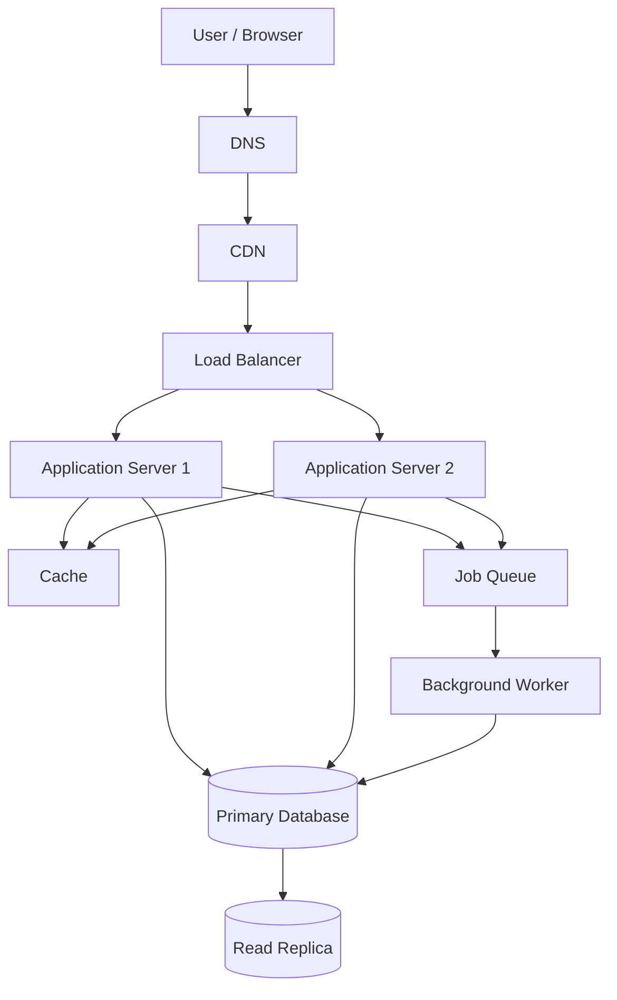

# QuickNotes System Architecture

## 1. Overview

QuickNotes is a note-taking application that allows users to create, view, update, and delete their notes. This document describes a proposed architecture for a real application that could support many users.

The current frontend assignment uses JSONPlaceholder for practice. The architecture described here is a design for a future production backend; it is not a claim that those backend services already exist.

## 2. Functional Requirements

The system should allow users to:

1. Register an account and log in.
2. Create a note with a title and optional body.
3. View a list of their notes.
4. View an individual note.
5. Update an existing note.
6. Delete a note.
7. Organize notes using tags.
8. Access only notes they are authorized to view or change.

## 3. Non-Functional Requirements

- **Availability:** The service should remain available during individual server failures.
- **Performance:** Common note-list requests should respond quickly under normal load.
- **Scalability:** The application should support growth in users and notes.
- **Security:** Use HTTPS, secure authentication, input validation, and ownership checks.
- **Reliability:** Back up the database and monitor failures.
- **Maintainability:** Separate the frontend, application logic, and data storage.
- **Data integrity:** Prevent invalid relationships and unauthorized changes to notes.

## 4. Estimated System Load

For planning purposes, assume:

- 1,000,000 registered users.
- 10% of users are active during a typical day: 100,000 daily active users.
- Each active user makes 50 read requests and 5 write requests per day.
- Average note size, including typical stored text and metadata, is approximately 2 KB.
- Each active user creates 2 new notes per day.

These are estimates for planning, not measured traffic.

### Read requests per second

Daily reads:

100,000 users × 50 reads = 5,000,000 reads per day.

Average reads per second:

5,000,000 ÷ 86,400 ≈ 58 reads per second.

### Write requests per second

Daily writes:

100,000 users × 5 writes = 500,000 writes per day.

Average writes per second:

500,000 ÷ 86,400 ≈ 6 writes per second.

Traffic peaks may be several times higher than these averages, so capacity testing would be necessary.

### Storage estimate

If each of the 100,000 daily active users creates 2 notes per day:

100,000 × 2 = 200,000 new notes per day.

At approximately 2 KB per note:

200,000 × 2 KB = 400 MB of new note data per day.

Estimated annual growth:

400 MB × 365 ≈ 146 GB per year.

This is a simplified estimate. It excludes indexes, database overhead, backups, replicas, and other application data. The estimate also assumes the active-user count stays constant.

## 5. High-Level Architecture

The following diagram shows the proposed system.

## 6. What Each Component Does

### Client / Browser

Displays the user interface and sends API requests. It lets users manage their notes.

### DNS

Translates the application's domain name into the appropriate network destination.

### CDN

Caches static files such as JavaScript, CSS, and images closer to users. This reduces load on the application servers and can improve page loading speed.

### Load Balancer

Distributes incoming requests across application servers. If one server becomes unhealthy, the load balancer can stop sending traffic to it.

### Application Servers

Run the backend API, authenticate users, validate requests, enforce note ownership, and coordinate database operations.

At least two application servers are used so that one can continue handling requests if the other fails.

### Cache

Stores frequently requested data temporarily, such as recently accessed notes or session-related data where appropriate. This can reduce repeated database reads.

Cache invalidation is important: when a note changes or is deleted, affected cached data must be updated or removed.

### Primary Database

Stores the authoritative records for users, notes, tags, and their relationships. Writes go to the primary database.

### Read Replica

Receives replicated database changes and serves suitable read queries. It can reduce read traffic on the primary database, although replication delay may mean some recent changes are not immediately visible.

### Job Queue

Stores background tasks so the application does not need to complete every task during the user's request. Examples include sending email notifications and processing exports.

### Background Worker

Consumes queued jobs and processes them separately from normal API requests. Failed jobs can be retried according to a defined retry policy.

## 7. Request Flows

### Flow A: GET /v1/notes

1. The user opens the notes page in the browser.
2. DNS resolves the application's domain.
3. The browser sends an HTTPS request through the CDN and load balancer.
4. The load balancer forwards the request to a healthy application server.
5. The application server validates the user's authentication token.
6. The application checks the cache for the requested user's notes.
7. If the cache does not contain usable data, the application retrieves the notes from the database or an appropriate read replica.
8. The application returns a JSON response containing the notes.
9. Where appropriate, the result is cached for later requests.
10. The browser displays the notes.

The application must ensure that the response contains only notes the authenticated user is permitted to access.

### Flow B: POST /v1/notes

1. The user submits the note form in the browser.
2. The browser sends an HTTPS POST request containing the title and optional body.
3. The load balancer forwards the request to a healthy application server.
4. The application validates the authentication token and request data.
5. The application obtains the user ID from the authenticated identity rather than trusting a user ID supplied by the client.
6. The application inserts the new note into the primary database.
7. The application invalidates or updates any affected cache entries.
8. The application returns `201 Created` with the created note and its ID.
9. If additional background work is required, such as sending a notification, the application can enqueue a job for a worker.

If saving the note fails, the API should return an appropriate error response instead of reporting success.

## Completing the POST /notes Request Flow

After the application validates the request and saves the new note to the primary database:

1. The database returns the newly created note, including its generated ID and timestamps.
2. The application invalidates or updates relevant cache entries so that future reads do not return stale note data.
3. If background work is needed, such as sending a notification, the application publishes a job to the queue.
4. The application returns `201 Created`, including the created note in the JSON response and a `Location` header identifying the new resource.
5. The browser displays the new note to the user.

If validation fails, the API returns an appropriate `4xx` response. If an unexpected server or database error occurs, the API returns a safe error response and logs diagnostic information without exposing secrets.

## Architecture Trade-Offs

### 1. Caching vs. Data Consistency

**Benefit:** Caching frequently accessed notes reduces database reads and can improve response times.

**Trade-off:** Cached information may become outdated after a note is updated or deleted.

**Decision:** Cache only suitable read-heavy data and define clear invalidation rules. The primary database remains the authoritative source of data.

### 2. Read Replicas vs. Immediate Consistency

**Benefit:** Read replicas distribute read traffic and reduce the workload on the primary database.

**Trade-off:** Replication may be delayed, so a read from a replica might not immediately reflect a recent write.

**Decision:** Send writes to the primary database. Use the primary for reads that require immediate consistency, and use replicas for suitable read-heavy queries.

### 3. Background Queues vs. Operational Complexity

**Benefit:** Queues allow slow tasks, such as sending email notifications, to run outside the main API request.

**Trade-off:** Queues and workers introduce more components to monitor, retry, and maintain.

**Decision:** Use background processing for tasks that do not need to finish before the API responds. Make jobs safe to retry and handle duplicate processing.

## Preventing and Handling Single Points of Failure

A single point of failure is a component whose failure can make all or part of the service unavailable.

### Application Servers

Run at least two application server instances behind a load balancer. Configure health checks so unhealthy instances are removed from service. Deploy updates gradually to reduce the chance of all instances failing together.

### Load Balancer

Use a managed or redundant load-balancing service with health checks and failover. Avoid relying on a single manually maintained load-balancer instance.

### Primary Database

The primary database is a critical dependency. Use automated backups, point-in-time recovery where supported, monitoring, and a tested failover procedure. A healthy replica can be promoted if the primary fails, but the procedure must account for replication lag and possible data loss.

### Read Replica

If a read replica fails, route eligible read queries to another healthy replica or temporarily to the primary database, provided the primary has sufficient capacity. Monitor replication lag and avoid using a replica for reads that require immediate consistency.

### Cache

If the cache becomes unavailable, the application should fall back to the database where practical. Because this can increase database traffic, configure timeouts, connection limits, monitoring, and capacity safeguards.

### Queue and Background Workers

Use durable queues where appropriate, monitor queue depth, and retry transient failures. Send repeatedly failing jobs to a dead-letter queue for investigation. The API should not report a core operation as successful unless the required database write has succeeded.

### Regional Outage and Data Recovery

Keep backups separate from the primary production environment and, where required, in another region. Document and regularly test restoration and disaster-recovery procedures. Multi-region failover can improve resilience but adds cost and operational complexity.

## Conclusion

This architecture uses redundant application servers, health checks, database backups, replication, caching, and background processing to improve performance and reliability. These components also introduce trade-offs involving consistency, cost, and operational complexity. Load testing, security testing, monitoring, and recovery exercises should be completed before the system is used in production.

## 8. Architecture Trade-Offs

### Trade-off 1: Cache vs. data consistency

**Benefit:** A cache reduces repeated database reads and can improve response time.

**Cost:** Cached data may become stale after a note is changed or deleted.

**Decision:** Use caching for suitable read-heavy requests, with clear invalidation rules. Do not rely on the cache as the authoritative source of data.

### Trade-off 2: Read replicas vs. immediate consistency

**Benefit:** Read replicas can distribute read traffic and reduce pressure on the primary database.

**Cost:** Replication is not always immediate, so a recently updated note might briefly appear outdated when read from a replica.

**Decision:** Use the primary database for writes and use the primary for reads that require immediate consistency. Use replicas for suitable read-heavy operations.

### Trade-off 3: Background processing vs. operational complexity

**Benefit:** Queues and workers keep slow tasks out of the main request path.

**Cost:** They introduce additional services, monitoring requirements, retries, and possible duplicate job processing.

**Decision:** Use a queue for tasks that can safely run asynchronously. Design workers to handle retries and duplicate jobs.

## 9. Single Points of Failure and Recovery

### Application server failure

Run at least two application servers behind a health-checking load balancer. If one fails, the other can continue serving requests.

### Load balancer failure

Use a managed or redundant load-balancing service where possible. Configure health checks and failover to reduce dependence on one instance.

### Primary database failure

Use automated backups, point-in-time recovery where supported, monitoring, and a tested failover procedure. A replica may be promoted if the primary fails, but failover must account for possible replication lag and data loss.

### Cache failure

The application should be able to fall back to the database when practical. Cache failure may increase database load, so connection limits and monitoring are important.

### Queue or worker failure

Persist queued jobs, monitor queue depth, retry transient failures, and send repeatedly failing jobs to a dead-letter queue for investigation.

### Regional outage

For stronger disaster recovery, maintain backups outside the primary region and document how to restore the service in another region. This adds cost and operational complexity.

## 10. Conclusion

This architecture separates user-facing delivery, API processing, caching, persistent storage, and background work. Load balancing and redundant application servers improve availability, while database backups and recovery procedures protect data. Caching and read replicas can improve read performance, but they require careful consistency and failure-handling decisions.

The design should be validated through load testing, security testing, monitoring, and recovery exercises before production use.

## Completing the POST /notes Request Flow

After the application server validates the incoming request and confirms that the user is authorized, it sends the new note to the primary database. The database creates the record and returns the saved note, including its unique ID and timestamps.

The application server then:

1. Confirms that the database transaction completed successfully.
2. Invalidates any cached note lists or cached data affected by the new note.
3. Publishes optional background work to a durable queue if additional processing is required, such as notifications or analytics.
4. Returns an HTTP `201 Created` response containing the newly created note and a `Location` header identifying the new resource.

The frontend receives the response, updates the displayed note list, and informs the user that the note was created successfully. If validation fails, the API returns `400 Bad Request`; if authentication or authorization fails, it returns `401 Unauthorized` or `403 Forbidden`. Unexpected server or database failures return an appropriate `500 Internal Server Error` or other suitable server error without exposing sensitive implementation details.

If a request fails after the client sends it, the client should avoid blindly retrying a non-idempotent create request. For production use, an idempotency key can help prevent duplicate notes when a client retries after an uncertain network failure.

## Architectural Trade-Offs

### 1. Read Replicas: Performance vs. Read-After-Write Consistency

**Decision:** Route most read requests to database replicas while directing writes to the primary database.

**Benefits:**
- Distributes read traffic across multiple database servers.
- Reduces pressure on the primary database.
- Improves read throughput as the number of users grows.

**Trade-offs and risks:**
- Replicas may lag behind the primary database.
- A user may create a note and not immediately see it in a subsequent read served by a replica.
- Replication and failover add operational complexity.

**Mitigation:** Use the primary database for read-after-write operations when immediate consistency is required. For ordinary reads, allow replicas to serve requests where slight delays are acceptable. Monitor replication lag and route reads away from unhealthy or excessively delayed replicas.

### 2. Caching: Lower Latency vs. Data Freshness

**Decision:** Cache frequently requested note lists and other suitable read results to reduce database load.

**Benefits:**
- Reduces response times for common read requests.
- Decreases repeated queries to the database.
- Helps the system support high traffic more efficiently.

**Trade-offs and risks:**
- Cached results may become stale after a note is created, updated, or deleted.
- Cache invalidation adds complexity.
- A cache outage can increase database traffic sharply.

**Mitigation:** Invalidate or update affected cache entries after successful writes, use appropriate expiration times, and monitor cache health. If the cache becomes unavailable, allow the application to fall back to the database, with rate limiting and capacity safeguards to prevent overload.

## Eliminating Single Points of Failure

The system should avoid relying on any single server or component whose failure would make the entire service unavailable.

### Load Balancer

- Use a managed or redundant load-balancing service with health checks.
- Route traffic only to healthy application instances.
- Configure the infrastructure so that a single load-balancer instance or availability-zone failure does not take down the service.
- Monitor request failures, latency, and backend health.

### Application Tier

- Run at least two application instances across separate failure domains or availability zones.
- Keep application servers stateless where practical so that requests can be handled by any healthy instance.
- Automatically replace failed instances and scale capacity based on demand.
- Use timeouts, bounded retries, and circuit breakers for dependencies to prevent cascading failures.

### Primary Database

- Use automated backups and point-in-time recovery.
- Configure a tested high-availability failover mechanism with a standby or managed database service.
- Replicate data to a standby in a separate failure domain where supported.
- Monitor database health, storage capacity, replication status, and connection usage.
- Regularly test recovery procedures and document the recovery-time and recovery-point objectives.

A primary database remains a critical dependency for writes, so replication alone is not sufficient. Automated failover, recoverable backups, and tested restoration procedures are required to reduce downtime and data-loss risk.

### Replicas, Cache, and Background Workers

- Configure read replicas so that unhealthy replicas can be removed from read routing, with fallback to the primary when capacity permits.
- Make the cache optional for correctness: if it fails, the application should still be able to serve requests from the database when safe to do so.
- Use a durable message queue for background jobs, with retry policies, dead-letter handling, and monitoring.
- Make background jobs safe to retry to avoid duplicate side effects.
- Apply backpressure and capacity limits during dependency outages.

### Monitoring and Recovery

- Collect centralized logs, metrics, and distributed traces.
- Alert on elevated error rates, high latency, database saturation, replication lag, and failed health checks.
- Test failure scenarios through controlled recovery exercises.
- Maintain documented incident-response and disaster-recovery procedures.

These measures reduce the impact of individual component failures. They do not guarantee zero downtime; resilience depends on implementation, capacity planning, monitoring, and regular testing.
