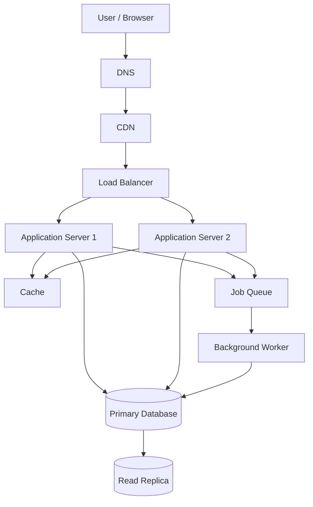

# QuickNotes System Architecture

## 1. Overview

QuickNotes is a note-taking application that allows users to create, view, update, and delete their notes. This document describes a proposed architecture for a real application that could support many users.

The current frontend assignment uses JSONPlaceholder for practice. The architecture described here is a design for a future production backend; it is not a claim that those backend services already exist.

## 2. Functional Requirements

The system should allow users to:

1. Register an account and log in.
2. Create a note with a title and optional body.
3. View a list of their notes.
4. View an individual note.
5. Update an existing note.
6. Delete a note.
7. Organize notes using tags.
8. Access only notes they are authorized to view or change.

## 3. Non-Functional Requirements

- **Availability:** The service should remain available during individual server failures.
- **Performance:** Common note-list requests should respond quickly under normal load.
- **Scalability:** The application should support growth in users and notes.
- **Security:** Use HTTPS, secure authentication, input validation, and ownership checks.
- **Reliability:** Back up the database and monitor failures.
- **Maintainability:** Separate the frontend, application logic, and data storage.
- **Data integrity:** Prevent invalid relationships and unauthorized changes to notes.

## 4. Estimated System Load

For planning purposes, assume:

- 1,000,000 registered users.
- 10% of users are active during a typical day: 100,000 daily active users.
- Each active user makes 50 read requests and 5 write requests per day.
- Average note size, including typical stored text and metadata, is approximately 2 KB.
- Each active user creates 2 new notes per day.

These are estimates for planning, not measured traffic.

### Read requests per second

Daily reads:

100,000 users × 50 reads = 5,000,000 reads per day.

Average reads per second:

5,000,000 ÷ 86,400 ≈ 58 reads per second.

### Write requests per second

Daily writes:

100,000 users × 5 writes = 500,000 writes per day.

Average writes per second:

500,000 ÷ 86,400 ≈ 6 writes per second.

Traffic peaks may be several times higher than these averages, so capacity testing would be necessary.

### Storage estimate

If each of the 100,000 daily active users creates 2 notes per day:

100,000 × 2 = 200,000 new notes per day.

At approximately 2 KB per note:

200,000 × 2 KB = 400 MB of new note data per day.

Estimated annual growth:

400 MB × 365 ≈ 146 GB per year.

This is a simplified estimate. It excludes indexes, database overhead, backups, replicas, and other application data. The estimate also assumes the active-user count stays constant.

## 5. High-Level Architecture

The following diagram shows the proposed system.

## 6. What Each Component Does

### Client / Browser

Displays the user interface and sends API requests. It lets users manage their notes.

### DNS

Translates the application's domain name into the appropriate network destination.

### CDN

Caches static files such as JavaScript, CSS, and images closer to users. This reduces load on the application servers and can improve page loading speed.

### Load Balancer

Distributes incoming requests across application servers. If one server becomes unhealthy, the load balancer can stop sending traffic to it.

### Application Servers

Run the backend API, authenticate users, validate requests, enforce note ownership, and coordinate database operations.

At least two application servers are used so that one can continue handling requests if the other fails.

### Cache

Stores frequently requested data temporarily, such as recently accessed notes or session-related data where appropriate. This can reduce repeated database reads.

Cache invalidation is important: when a note changes or is deleted, affected cached data must be updated or removed.

### Primary Database

Stores the authoritative records for users, notes, tags, and their relationships. Writes go to the primary database.

### Read Replica

Receives replicated database changes and serves suitable read queries. It can reduce read traffic on the primary database, although replication delay may mean some recent changes are not immediately visible.

### Job Queue

Stores background tasks so the application does not need to complete every task during the user's request. Examples include sending email notifications and processing exports.

### Background Worker

Consumes queued jobs and processes them separately from normal API requests. Failed jobs can be retried according to a defined retry policy.

## 7. Request Flows

### Flow A: GET /v1/notes

1. The user opens the notes page in the browser.
2. DNS resolves the application's domain.
3. The browser sends an HTTPS request through the CDN and load balancer.
4. The load balancer forwards the request to a healthy application server.
5. The application server validates the user's authentication token.
6. The application checks the cache for the requested user's notes.
7. If the cache does not contain usable data, the application retrieves the notes from the database or an appropriate read replica.
8. The application returns a JSON response containing the notes.
9. Where appropriate, the result is cached for later requests.
10. The browser displays the notes.

The application must ensure that the response contains only notes the authenticated user is permitted to access.

### Flow B: POST /v1/notes

1. The user submits the note form in the browser.
2. The browser sends an HTTPS POST request containing the title and optional body.
3. The load balancer forwards the request to a healthy application server.
4. The application validates the authentication token and request data.
5. The application obtains the user ID from the authenticated identity rather than trusting a user ID supplied by the client.
6. The application inserts the new note into the primary database.
7. The application invalidates or updates any affected cache entries.
8. The application returns `201 Created` with the created note and its ID.
9. If additional background work is required, such as sending a notification, the application can enqueue a job for a worker.

If saving the note fails, the API should return an appropriate error response instead of reporting success.

## 8. Architecture Trade-Offs

### Trade-off 1: Cache vs. data consistency

**Benefit:** A cache reduces repeated database reads and can improve response time.

**Cost:** Cached data may become stale after a note is changed or deleted.

**Decision:** Use caching for suitable read-heavy requests, with clear invalidation rules. Do not rely on the cache as the authoritative source of data.

### Trade-off 2: Read replicas vs. immediate consistency

**Benefit:** Read replicas can distribute read traffic and reduce pressure on the primary database.

**Cost:** Replication is not always immediate, so a recently updated note might briefly appear outdated when read from a replica.

**Decision:** Use the primary database for writes and use the primary for reads that require immediate consistency. Use replicas for suitable read-heavy operations.

### Trade-off 3: Background processing vs. operational complexity

**Benefit:** Queues and workers keep slow tasks out of the main request path.

**Cost:** They introduce additional services, monitoring requirements, retries, and possible duplicate job processing.

**Decision:** Use a queue for tasks that can safely run asynchronously. Design workers to handle retries and duplicate jobs.

## 9. Single Points of Failure and Recovery

### Application server failure

Run at least two application servers behind a health-checking load balancer. If one fails, the other can continue serving requests.

### Load balancer failure

Use a managed or redundant load-balancing service where possible. Configure health checks and failover to reduce dependence on one instance.

### Primary database failure

Use automated backups, point-in-time recovery where supported, monitoring, and a tested failover procedure. A replica may be promoted if the primary fails, but failover must account for possible replication lag and data loss.

### Cache failure

The application should be able to fall back to the database when practical. Cache failure may increase database load, so connection limits and monitoring are important.

### Queue or worker failure

Persist queued jobs, monitor queue depth, retry transient failures, and send repeatedly failing jobs to a dead-letter queue for investigation.

### Regional outage

For stronger disaster recovery, maintain backups outside the primary region and document how to restore the service in another region. This adds cost and operational complexity.

## 10. Conclusion

This architecture separates user-facing delivery, API processing, caching, persistent storage, and background work. Load balancing and redundant application servers improve availability, while database backups and recovery procedures protect data. Caching and read replicas can improve read performance, but they require careful consistency and failure-handling decisions.

The design should be validated through load testing, security testing, monitoring, and recovery exercises before production use.
